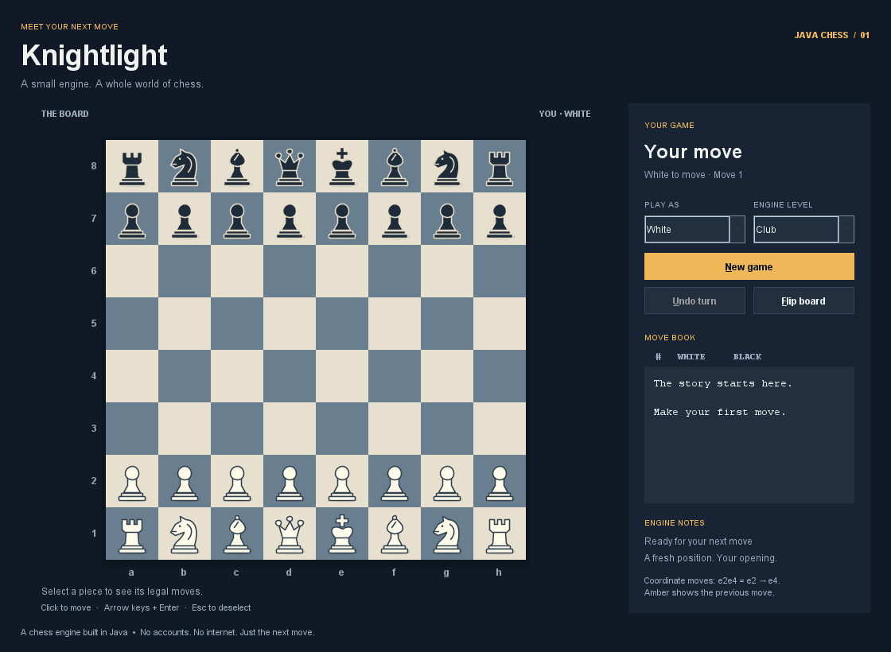

# Knightlight

A small chess game and chess engine built in Java for a Software II bonus project. Play against an original search engine in a desktop window, inspect how it chooses moves, and learn from a compact codebase.

Knightlight is an educational engine, far weaker than Stockfish. It runs entirely on your computer: no accounts, API keys, internet connection, or AI service are needed to play.

[Source repository](https://github.com/DiegoFrias05/knightlight-java-chess) · [Download the runnable JAR](https://github.com/DiegoFrias05/knightlight-java-chess/releases/latest)



## Requirements

- **JDK 17 or newer** to build and run from source. The JDK includes both `java` and `javac`; both should be available in your terminal.
- Windows, macOS, or Linux with a graphical desktop.
- No Maven, Gradle, or external Java libraries.

Check your installation with `java -version` and `javac -version`. If either command is missing, install a JDK and reopen your terminal or VS Code.

## Run the game

Download or clone this repository and open its folder.

```sh
git clone https://github.com/DiegoFrias05/knightlight-java-chess.git
cd knightlight-java-chess
```

**Windows:** Double-click `run.bat`, or open a terminal in the project folder and run:

```powershell
.\run.bat
```

**macOS / Linux:** Open a terminal in the project folder and run:

```sh
sh run.sh
```

The run script compiles the source and opens the game. On Windows, keep the console open while playing so you can see any startup errors.

To build without launching, use `.\build.bat` on Windows or `sh build.sh` on macOS/Linux. This produces `build/knightlight.jar`, which can also be run with:

```sh
java -jar build/knightlight.jar
```

A prebuilt JAR needs only Java 17 or newer to run; building the source requires the JDK.
For the release download, save `knightlight.jar`, open a terminal in its folder, and run `java -jar knightlight.jar`.

## Play

1. Choose White or Black and the engine's difficulty. Changing sides starts a new game and turns the board toward you.
2. Click one of your pieces to see its legal destinations. Click a highlighted square to move.
3. For a pawn promotion, choose queen, rook, bishop, or knight.
4. Use **Undo turn** to take back your move and the engine's reply, **Flip board** to change the view, and **New game** to start over. Undo and New game also cancel an engine search in progress.

The window shows coordinate move history (for example, `e2e4`), game status, and the engine's depth, positions searched, time, and evaluation. Use the arrow keys to move the board cursor, Enter or Space to select a square, and Escape to clear a selection.

Difficulty sets a maximum depth and an approximate time budget per move:

- **Beginner:** 2 plies, 350 milliseconds.
- **Club:** 3 plies, 1 second.
- **Challenger:** 4 plies, 2.5 seconds.

A ply is one player's move. The engine may complete a shallower search when time runs out, and its capture search can look beyond the normal depth. These names describe settings, not measured chess ratings.

## What it implements

- Legal move generation, check, checkmate, and stalemate.
- Castling, en passant, and all four promotion choices.
- Automatic threefold repetition and fifty-move draws, plus conservative detection of insufficient material.
- Iterative deepening with negamax, alpha-beta pruning, and a capture-focused quiescence search.
- An evaluation combining piece values and positional preferences.
- A Swing interface with legal-move highlights, move history, undo, and board flipping.

**Draw-rule simplification:** In tournament chess, threefold repetition and the fifty-move rule normally allow a player to claim a draw. Knightlight ends the game automatically at those thresholds. The fifty-move threshold means 100 individual moves without a pawn move or capture. Material detection covers obvious cases such as king versus king and king plus a single minor piece versus king; it does not attempt to solve every possible dead position. See the [FIDE Laws of Chess](https://handbook.fide.com/chapter/e012023) for the full rules.

The engine has no opening book, endgame tablebase, neural network, multiplayer server, or UCI protocol interface. Its limited search can miss tactics and make mistakes. The aim is readable Java and a complete playable project.

## Run the tests

**Windows:**

```powershell
.\test.bat
```

**macOS / Linux:**

```sh
sh test.sh
```

Tests use ordinary Java entry points and small assertion helpers, with no test framework dependency. They check move-generation counts, special moves, game outcomes, engine behavior, and UI behavior. The scripts report failures and return an error status when a check fails.

GitHub Actions also runs the suite on Windows, macOS, and Linux with Java 17 and 21 whenever changes are pushed.

## Explore the code in VS Code

Open this repository folder in VS Code. Java extensions are optional; the scripts above work from its terminal. Start with `Move`, then `Position` and `Game`, before reading the engine and interface.

```text
src/main/java/chess/
  ChessApp.java       Application entry point
  Move.java           A move's origin, destination, and promotion
  Position.java       Immutable board state and chess rules
  Game.java           History, repetitions, outcomes, and undo
  Engine.java         Search and evaluation
  ChessWindow.java    Window, controls, and game flow
  BoardPanel.java     Board drawing and mouse interaction
src/test/java/chess/  Standalone test programs
docs/DESIGN.md        Architecture and algorithm explanation
docs/AI_COLLABORATION.md  How AI was used and review prompts
build.bat / build.sh  Compile and package
run.bat / run.sh      Build and launch
test.bat / test.sh    Compile and test
```

Read [the design notes](docs/DESIGN.md) for the main algorithms and [the AI collaboration record](docs/AI_COLLABORATION.md) for an honest account of how this project was developed.

## Before you submit

- Run the tests and play a complete game yourself.
- Read the main classes and be ready to explain legal moves, recursive search, alpha-beta pruning, and why the engine sometimes plays poorly.
- Add your own review and reflection to the AI collaboration record; do not present generated work as work you wrote independently.
- Open the public GitHub repository link while signed out and verify that the README and source are visible. Submit that repository link using your course's instructions.

## License

[MIT](LICENSE).
